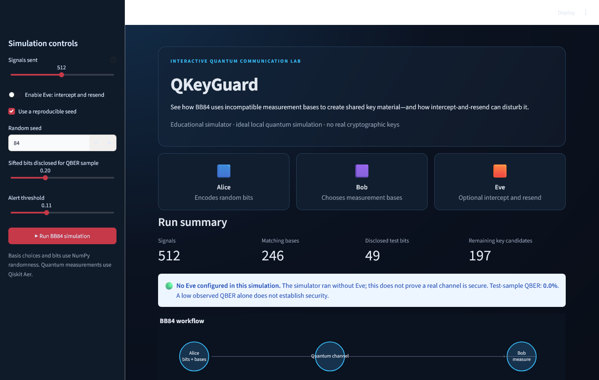
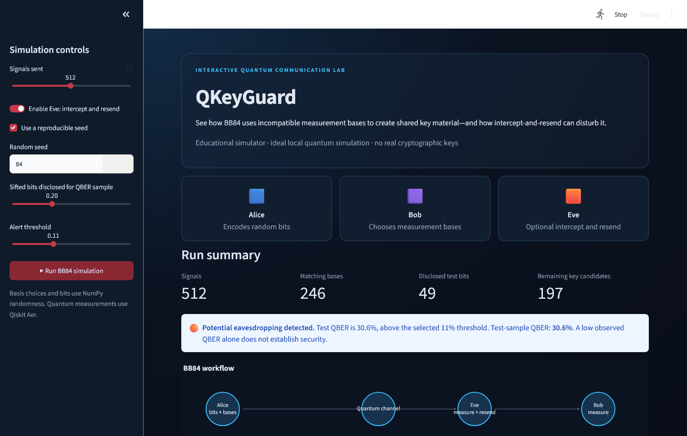
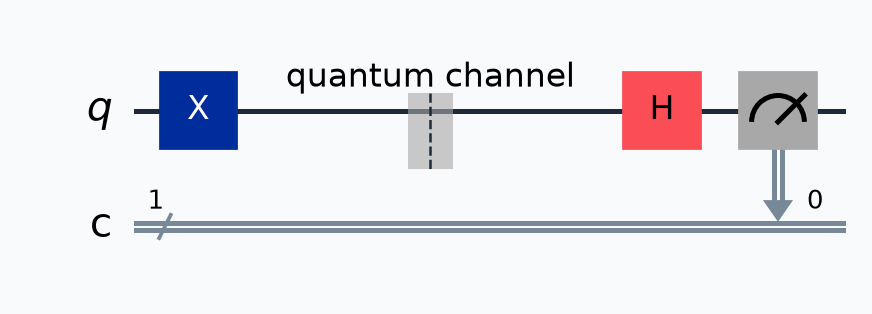
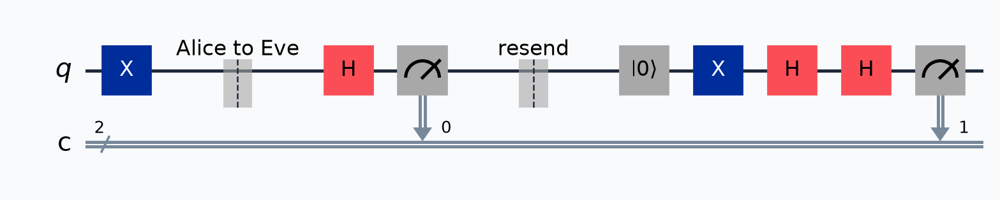
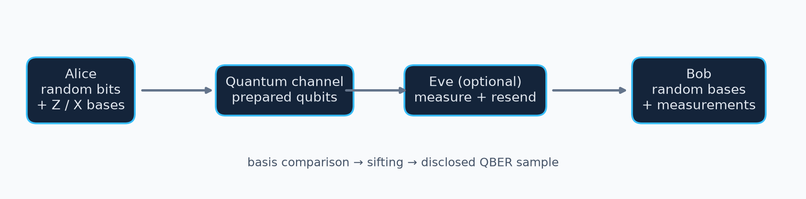

# QKeyGuard

An educational BB84 quantum key distribution simulator. Alice encodes random bits in the computational (Z) or Hadamard (X) basis; Bob measures using independently chosen bases; optional Eve performs intercept-and-resend. The dashboard visualizes basis sifting, disclosed QBER samples, and the sifted candidate bits left after the sample is removed.

> **Teaching simulator only.** This project does not implement secure communication or produce cryptographic keys. It uses an ideal local simulator, displays protocol data for learning, and omits finite-key security proofs and post-processing.

## Problem and proposed solution

Quantum key distribution gives two parties a way to detect disturbance while establishing shared random key material. QKeyGuard makes the BB84 process inspectable: each transmitted signal is represented by an independent qubit within a Qiskit circuit batch, measurement results come from Qiskit Aer, and a second quantum simulation stage models Eve's measured result controlling the state she resends.

## How BB84 works

1. Alice independently chooses a random bit and a random basis for each qubit. In Z, `|0⟩` and `|1⟩` encode 0 and 1. In X, `|+⟩` and `|−⟩` encode 0 and 1.
2. Alice prepares Z states with an optional X gate. She applies H for X-basis states.
3. Bob independently chooses a basis and measures. Applying H before computational-basis measurement measures in X.
4. Over a public channel, Alice and Bob reveal bases (not bit values) and keep positions where bases match. These bits form the sifted raw key.
5. They disclose a random subset of the sifted bits to estimate QBER. Those disclosed bits are discarded. Remaining matching bits are only **secret-key candidates** in this demo.
6. Eve's optional intercept-and-resend measures each signal in a random basis and sends a newly prepared state based on her result. In ideal BB84, full random-basis intercept-and-resend produces an expected 25% error rate on sifted bits; finite samples vary.

A qubit is a two-level quantum state. Superposition means a state can be expressed as a combination of basis states; measurement returns a classical outcome and changes the measured state. An incorrect-basis measurement is random for BB84 states, which creates a chance of detectable errors.

Real BB84 needs an authenticated classical channel, error correction, and privacy amplification. A low measured QBER is not proof of security. This application is idealized and includes no channel loss, device noise, detector attacks, finite-key bounds, proof, or key distillation.

## Architecture

```text
app.py                       Streamlit dashboard
src/bb84_protocol.py         Qiskit/Aer circuit generation and protocol run
src/security_analysis.py     Threshold interpretation and insufficient-data cases
src/visualization.py         Plotly, Pandas, and Matplotlib figures
tests/                       Protocol, attack, reproducibility, and edge-case tests
notebooks/                   Walk-through notebook
assets/diagrams/             Circuit and workflow image assets
assets/screenshots/          Dashboard capture generated from the running app
```

Signals are grouped into independent circuit batches that fit Aer’s backend width. The matrix product state method keeps the state representation efficient because these signals do not interact. With Eve, Alice-to-Eve and Eve-to-Bob are separate Aer runs; Eve's measured classical bit and basis control the resent state's preparation. Protocol bits and basis choices use a NumPy seeded generator when a seed is selected; quantum measurement uses Aer and a derived simulator seed.

## Technology

- Python 3.12 (3.11+ supported)
- Qiskit and Qiskit Aer
- NumPy, Pandas, Matplotlib, Plotly
- Streamlit
- Pytest
- Jupyter Notebook

## Installation

Create and activate an environment, then install requirements:

```powershell
py -3.12 -m venv .venv
.venv\Scripts\Activate.ps1
python -m pip install --upgrade pip
python -m pip install -r requirements.txt
```

The same `requirements.txt` is intended for Python 3.11 or later. If `py -3.12` is unavailable, create the environment with `uv venv --python 3.12 .venv`, then install with `uv pip install --python .venv\Scripts\python.exe -r requirements.txt`.

## Run the application

```powershell
streamlit run app.py
```

The included Streamlit configuration binds the development app to loopback (`127.0.0.1`). Use the sidebar to set the number of signals, toggle Eve, select a random seed, and choose the fraction of sifted bits to reveal for the QBER sample. Press **Run BB84 simulation**. The tabs show protocol results, a Qiskit circuit, measurement and QBER visualizations, and a short BB84 explanation.

## Reading the results

- **Raw bits:** Alice's generated bits and Bob's measurements for all signals. Displayed for demonstration, not private data.
- **Basis matches:** positions where Alice and Bob used the same basis.
- **Sifted raw key:** matching-basis bits before sample disclosure.
- **Disclosed test bits:** public sample used for the QBER estimate; these bits are removed.
- **Remaining key candidates:** matching bits not disclosed. This is not a final secret key.
- **Test QBER:** errors among only disclosed test bits, as parties would estimate it.
- **Diagnostic sifted QBER:** full simulator-known disagreements, shown only to compare the controlled scenarios. A real protocol cannot see unrevealed bits.

Without Eve, ideal noiseless simulation gives zero sifted QBER. With Eve, the expected sifted QBER is 25%; finite-sample outcomes fluctuate. A status indicator above a selected threshold signals possible disturbance; a low estimate does not certify security.

### Example run

With 512 signals, seed `84`, and a 20% test sample, these runs produced 246 matching-basis positions. With Eve disabled, the 49 disclosed bits had 0.0% QBER, leaving 197 candidates. With Eve enabled, the 49-bit test sample measured 30.6% QBER, with 197 positions remaining outside the disclosed sample. The screenshots show these actual seeded runs; other seeds and sample sizes vary.

## Generated artifacts

The repository includes circuit drawings and a dashboard screenshot under `assets/`. They are captured/generated from the implementation and are illustrative; displayed random runs may differ.

| No Eve | Intercept and resend |
| --- | --- |
|  |  |

**No-Eve circuit**



**Eve intercept-and-resend circuit**



**Protocol workflow**



The circuit and workflow drawings can be regenerated with `python scripts/generate_assets.py`.

## Tests

```powershell
python -m pytest -q
```

The automated suite checks both basis encodings, ideal no-Eve behavior, seeded reproducibility, matching-basis sifting, sample-only QBER, insufficient material, and the expected attack error rate. Statistical tests use fixed seeds for reproducibility but assert ranges rather than hardcoded measurement outputs.

## Hackathon demo outline (3–5 minutes)

1. **Problem (30 sec):** sharing a key over a channel can expose it; BB84 uses quantum measurement disturbance to detect interception.
2. **Protocol (45 sec):** Alice selects random bits and Z/X bases; Bob independently measures; they keep matching-basis positions.
3. **No Eve (45 sec):** run the ideal case and point out zero sifted errors; explain that test positions are disclosed and removed.
4. **With Eve (60 sec):** enable random-basis intercept/resend; show mismatching outcomes and the QBER estimate. Mention that 25% is an expectation over many sifted bits.
5. **Implementation (30 sec):** show X/H/measurement in the circuit and Eve's measurement-controlled resend.
6. **Limits (30 sec):** this is a local ideal simulator, not deployable cryptography; authentication, error correction, and privacy amplification are required.

## License

MIT. See [LICENSE](LICENSE).

## References

- IBM Quantum Learning, [Quantum Key Distribution](https://quantum.cloud.ibm.com/learning/en/modules/computer-science/quantum-key-distribution).
- Bennett and Brassard, [Quantum cryptography: Public key distribution and coin tossing](https://doi.org/10.1016/j.tcs.2014.05.025), original 1984 paper republished in *Theoretical Computer Science* in 2014.
- IBM Quantum Documentation, [Local simulators](https://quantum.cloud.ibm.com/docs/en/guides/local-simulators).
- Qiskit Aer, [official documentation](https://qiskit.github.io/qiskit-aer/).
